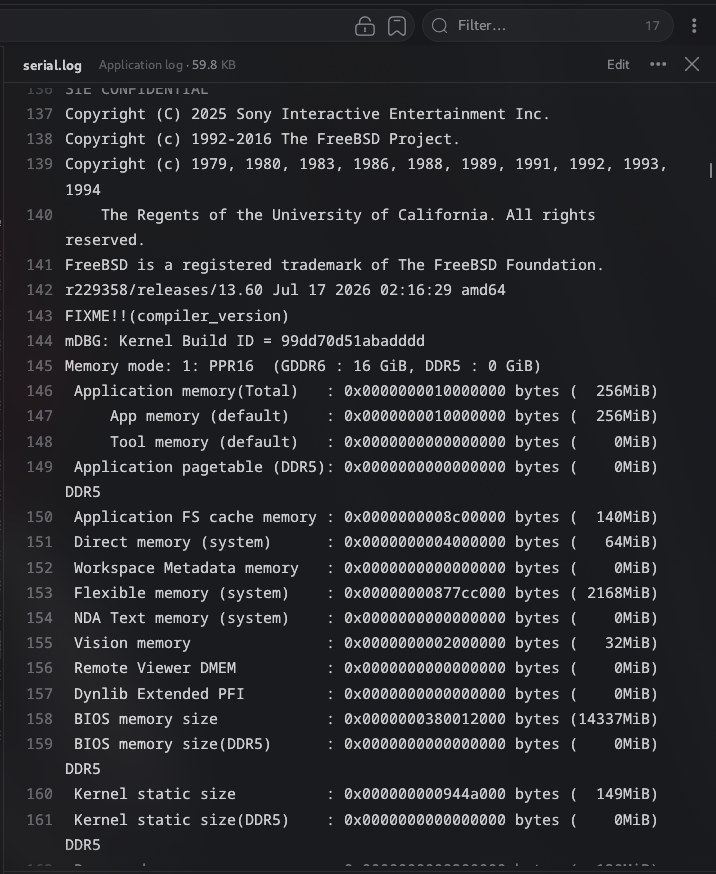
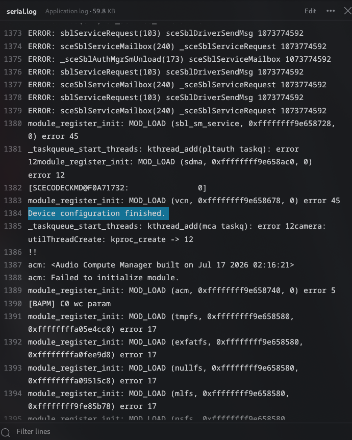
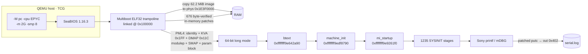
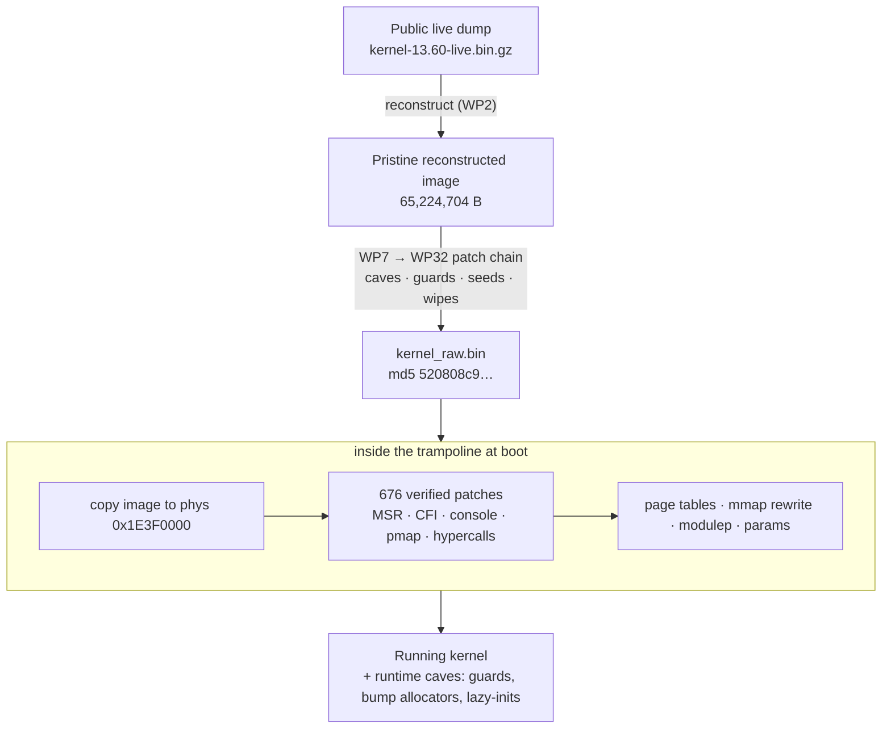

<div align="center">

# 🎮 PS5 13.60 Kernel → QEMU Boot Kit

### Booting Sony's unmodified Orbis OS kernel (FreeBSD-derived, OS 13.60) inside a plain x86-64 QEMU virtual machine —
### with a hand-built multiboot loader, 676 in-memory patches, and a reproducible chain of 50+ crash-site guards.


**[TL;DR](#-tldr) · [Status](#-status-at-a-glance) · [Quickstart](#-quickstart) · [Architecture](#-architecture) · [Deep dive](#-technical-deep-dive) · [Patch methodology](#-patch-methodology-caves-slots-seeds) · [Timeline](#-work-package-timeline-wp1--wp32) · [Layout](#-repository-layout) · [Integrity](#-integrity--reproducibility) · [Caveats](#-known-limitations--honest-caveats) · [Next steps](#-next-steps--triage-playbook)**

</div>

---

## 📌 TL;DR

This repository is a *research snapshot*: a complete, reproducible toolchain that takes the public
PS5 13.60 live kernel dump and gets Sony's real kernel to run its own `mi_startup()` SYSINIT march — banner,
memory-mode table, ~1000 sysctl registrations, CPU/APIC/ACPI enumeration, device-module wave, filesystem
registration, timecounters, TCP/IP init — on a stock QEMU `-M pc -cpu EPYC` machine. Nothing here emulates the PS5's
SoC; the kernel is booted *as an x86-64 FreeBSD kernel* and every place where it expects real PS5 hardware or
loader state is either neutralised, seeded, or answered by a tiny hand-assembled code cave.

<div align="center">



*Sony's real kernel printing its own banner, build ID and memory mode inside QEMU.*

</div>

### ⚡ 30-second start

```bash
# 1) unpack (the archive uses the BCJ2 filter: needs 7z / 7zz / p7zip, py7zr cannot extract it)
7z x ps5-13_60-qemu-boot-ultra.7z -o ps5-13.60-qemu-boot && cd ps5-13.60-qemu-boot

# 2) install QEMU (Debian/Ubuntu)
sudo apt install -y qemu-system-x86

# 3) boot (240 s cap; stops by itself after 45 s of serial silence); full output lands in serial.log
bash run.sh 240
```

Only `qemu-system-x86_64` is required — the BIOS files (`bios/`), the loader (`wp3_boot/trampoline.elf`) and the
patched kernel image (`wp3_boot/kernel_raw.bin`) ship inside the archive.

---

## 📊 Status at a glance

| Item | Value |
|---|---|
| **Shipped kernel image** | `wp3_boot/kernel_raw.bin` — **md5 `520808c90b58241f454baeae0db0c8cc`** (verified while preparing this README), exactly **65,224,704 bytes** |
| **Cumulative patch level** | WP1 → **WP32** (per `scripts/apply_all_wp1_to_wp32_patches.py`); documented in the worklog up to **WP29**, with WP30/31 (G52–G54) documented in the script headers |
| **Trampoline (loader) patches** | **676** in-memory patches (`wp3_boot/patches.inc`, `PATCH_COUNT equ 676`) applied *after* the image is copied to RAM |
| **Latest boot log** | `serial.log` — **1,436 lines**, no `Fatal trap` / `panic:` line anywhere in it |
| **Last line of the log** | `sx_slock(allproc): SceSwapper has nonsleeping lock` (current frontier; see [Next steps](#-next-steps--triage-playbook)) |
| **Furthest landmarks reached** | `Device configuration finished.` · `Timecounters tick every 1.000 msec` · `ipfw2 (+ipv6) initialized` · `Timecounter "TSC-low" … quality 1000` |
| **SYSINIT stages** | 1,235 unique stages after reconstruction (1,236 slots incl. terminator); last documented march: stages up to ≈ #1339 (`WP23: sysinit walk complete; parking.` is the designed park point) |
| **Machine** | `qemu-system-x86_64 -M pc -cpu EPYC -m 2G -smp 8`, **TCG** (no KVM required) |
| **Console path** | kernel `putc` → patched to `out 0x402` → QEMU `isa-debugcon` → `serial.log` |

### 🗺 Boot-log anatomy (line numbers refer to the shipped `serial.log`)

| Line | Landmark | Meaning |
|---:|---|---|
| 1 – 112 | SeaBIOS, PCI probing, `Relocating init…` | Firmware stage; the kit bundles SeaBIOS + option ROMs in `bios/` |
| 113 – 114 | `PS5-TRAMPOLINE: booting 13.60 kernel` → `entering long mode -> btext 0xffffffff9e642a90` | Our multiboot loader hands over to Sony's real cold entry point |
| 136 – 144 | `SIE CONFIDENTIAL`, copyright, `r229358/releases/13.60 Jul 17 2026 … amd64`, `mDBG: Kernel Build ID = 99dd70d51abadddd` | **First real Sony banner** |
| 145 – 163 | `Memory mode: 1: PPR16 (GDDR6 : 16 GiB, DDR5 : 0 GiB)` + memory profile table | App 256 MiB, FS-cache 140 MiB, direct 64 MiB, vision 32 MiB (profile sizes shrunk to fit the VM) |
| 164 – 1162 | **999** × `can't re-use a leaf (…)!` (from `swap_avail` … to `randompid`) | sysctl-tree registration storm (duplicate-leaf noise from the static image) |
| 1163 | `Preloaded elf kernel "kernel" at 0xffffffffa2224000.` | Preload-metadata chain (modulep) parsed |
| 1164 – 1191 | `CPU: AMD EPYC Processor`, `Hypervisor: Origin = "TCGTCGTCGTCG"`, `CPU Features: SMAP Enabled`, `Event timer "LAPIC" quality 400`, `ACPI APIC Table: <BOCHS BXPC>`, `FreeBSD/SMP: …` | CPU/cache identification, LAPIC event timer, ACPI/MADT, SMP enumeration |
| 1206 – 1208 | `lapic: Routing NMI -> LINT1 …` | IOAPIC/LAPIC setup complete |
| 1229 – 1230 | `contigmalloc failed.` / `MOD_LOAD (pfsmgr …) error 12` | Designed ENOMEM tolerance — first of many `error 12` module prints |
| 1260 | `hdcp packet is set to 1` | WP20/WP21 landmark (hypervisor settle-wait removed, G16) |
| **1384** | **`Device configuration finished.`** | WP22 landmark (sysinit sub 0x14) |
| 1385 – 1390 | `mca taskq` / `camera` error-12 prints, `acm: Failed to initialize module.` (error 5), `[BAPM] C0 wc param` | Post-landmark stages #1184+ |
| 1391 – 1405 | 15 × `MOD_LOAD (<fs>) error 17` — tmpfs, exfatfs, nullfs, mlfs, nsfs, ufs, pfs, udf2, ppr_pfs, transaction_pfs, bfs, transactionfs, cd9660, devfs, unionfs | EEXIST double-registration noise (the image statically pre-registers its filesystems) |
| 1406 – 1414 | `lapic: calib failed(…)` ×3 → `Timecounters tick every 1.000 msec` → `Session ID: 000…0` → `tcp_init … tcbhashsize auto tuned to 512` | Late-boot stages (WP27 era) |
| 1415 – 1430 | `ipfw2 (+ipv6) initialized`, `if_attachdomain1 called more than once on lo0`, `fake a53io ctrlr is loaded.`, `srtc` error 45, `failed to kick bufdaemon`, `invalid tsc freq` | Post-G53 stages |
| 1431 | `Timecounter "TSC-low" frequency 12500000 Hz quality 1000` | Passed the TSC-low registration (sysinit #1328, G54) |
| 1432 – 1436 | `a53mm … error 16`, `cdinit_proc kproc_create fail.`, `sceSblServiceSysMailSend 1073774592`, **`sx_slock(allproc): SceSwapper has nonsleeping lock`** | **Current frontier** |

<div align="center">



*Landmark at line 1,384: `Device configuration finished.`*

</div>

> **How to read the noise.** FreeBSD errno values: `error 12` = `ENOMEM`, `error 17` = `EEXIST`, `error 45` = `EOPNOTSUPP`,
> `error 16` = `EBUSY`, `error 5` = `EIO`. In this kit almost every kthread/kproc creation and many allocations *deliberately* fail with ENOMEM
> (the "ENOMEM era"), and the kernel's own error paths are what carry the boot forward. These are expected, not regressions.

---

## 🚀 Quickstart

### Requirements

| Tool | Needed for | Notes |
|---|---|---|
| `qemu-system-x86_64` ≥ 6 | all paths | BIOS roms are bundled in `bios/` (used via `-L ./bios`) |
| `7z` / `7zz` / `p7zip` | unpacking the archive | The archive uses the **BCJ2** filter — `py7zr` cannot extract it |
| `bash`, `curl`/`wget`, `gzip` | path B | to fetch the public dump |
| `python3` (stdlib) | paths B/C/D | `capstone` + `keystone` only if you want to *re-run analysis/patch scripts* |
| `nasm`, `ld` (binutils) | path C | rebuilds the trampoline from `scripts/trampoline.asm` |
| `gdb` ≥ 12 | optional | `gdb/` sessions attach to QEMU's gdbstub |

```bash
# Debian / Ubuntu — everything in one go
sudo apt install -y qemu-system-x86 p7zip-full nasm binutils python3 curl gzip gdb
python3 -m pip install --user capstone keystone-engine      # only for analysis / re-patching scripts
```

### Path A — boot the prebuilt image (fastest)

```bash
bash run.sh 240
```

`run.sh` auto-detects QEMU, wipes the old `serial.log`, boots, and **stops early after 45 s without new serial output**
(once the log is > 200 bytes), then prints the last 25 lines. If `wp3_boot/kernel_raw.bin` is missing it calls
`fetch_and_build.sh` (Path B) automatically.

### Path B — rebuild the kernel image from the public dump

```bash
bash fetch_and_build.sh
```

What it does: downloads `kernel-13.60-live.bin.gz` from the public GitHub repo (with a Git-LFS media-endpoint fallback),
decompresses it, and runs `build_kernel.py`, which verifies the **base md5** `ca43f306298bab963974f2c2b028f4b8`,
applies a zlib+base64-packed byte-diff, and asserts the **target md5** `520808c90b58241f454baeae0db0c8cc`.
If the image already verifies, it exits immediately ("Nothing to do").

### Path C — rebuild from the reconstructed ELF (the WP2 → WP3 original flow)

```bash
sudo apt install -y qemu-system-x86 nasm binutils python3
bash scripts/run_local.sh 150 ./ps5_kernel_1360_reconstructed.elf
```

Flow: `make_kernel_raw.py` (ELF → flat physical image) → `nasm -f elf32` + `ld -m elf_i386 -T wp3_boot/tramp.ld`
(trampoline, 676 patches) → `qemu-system-x86_64` TCG boot, console on debugcon `0x402` →
`wp3_boot/serial.log`. The ELF itself (62.2 MiB, sha256 `e87dbe643e285d0b59a18c926fc0eb1a20f3157ea99cde6d2e7ade5ea7b17cae`)
is **not** in this archive.

### Path D — move an existing WP29 image forward (WP29 → WP31)

```bash
cp /path/to/WP29/kernel_raw.bin wp3_boot/kernel_raw.bin      # md5 e9cccbeb03f468c4708d53361fbde1f6
python3 scripts/wp31_build_from_wp29.py                      # idempotent; byte-verifies every patch site
bash run.sh 240
```

Chain: `WP29 e9cccbeb… ──G52──▶ WP30 706ec1ee… ──G53+G54──▶ WP31 c85632c9…`. The script refuses to write anything
if the input md5 is not the expected WP29 base.

### The QEMU command line (copy-paste ready)

```bash
qemu-system-x86_64 -L ./bios \
  -M pc -cpu EPYC -m 2G -smp 8 \
  -kernel wp3_boot/trampoline.elf \
  -initrd wp3_boot/kernel_raw.bin \
  -display none -serial null -monitor none \
  -chardev file,id=dbg,path=serial.log \
  -device isa-debugcon,iobase=0x402,chardev=dbg \
  -no-reboot
```

| Piece | Role |
|---|---|
| `-M pc -cpu EPYC` | i440fx PC with Zen-family CPUID (the kernel identifies as `AMD EPYC Processor`) |
| `-kernel …/trampoline.elf` | our multiboot ELF32 loader, linked at `0x100000` |
| `-initrd …/kernel_raw.bin` | delivered as a multiboot *module*: the flat 62.2 MiB kernel image |
| `-serial null -monitor none -display none` | headless; the real UART is intentionally unused |
| `-chardev file … -device isa-debugcon,iobase=0x402` | console sink — the kernel's patched `putc` writes to I/O port `0x402` |
| `-no-reboot` | a triple fault ends the run instead of reboot-looping |

**Why these particular values**

| Flag | Why it matters |
|---|---|
| `-cpu EPYC` | Zen-family CPUID/feature bits (the kernel identifies as `AMD EPYC Processor`); `CPU Features: SMAP Enabled` |
| `-m 2G` | The app-memory carve base was patched from 4 GiB to 1 GiB (WP5, root-cause #7); profiles then carve exactly `[1 GiB, 2 GiB)`. SMAP top is `0x80000000` |
| TCG (no `-enable-kvm`) | Unknown MSRs read as 0 on the reference QEMU and the in-kernel MSR sites were neutralised; under KVM a different host may still `#GP` on remaining `rdmsr` sites. Try KVM only after a clean TCG run |
| `-smp 8` | Matches the live machine's CPU count; the trampoline never sends INIT-SIPI, and the SMP-gate residue was zeroed so everything takes the single-CPU fast path |
| `-no-reboot` | A fault cascade ends QEMU rather than reboot-looping |


---

## 🧱 Architecture

### Boot pipeline



### Three layers of patching



| Layer | Where it lives | Applied | Typical content |
|---|---|---|---|
| **1 · Baked image patches** | inside `kernel_raw.bin` (built by `scripts/wp*_patch_*.py`, or in one shot by `build_kernel.py` / `apply_all_wp1_to_wp32_patches.py`) | offline | code caves & slots, `.data` residue wipes, seed pointers, designed-exit retargets |
| **2 · Trampoline patches** | `wp3_boot/patches.inc` (676 entries; each = image offset + length + *expected original bytes* + *replacement bytes*) | at boot, after the image copy; the loader halts with `patch mismatch` if an expected byte differs | 33 `vmmcall` → `xor eax,eax; nop` (hypercall "returns 0"), 37 `wrmsr` NOPs, 481 `rdmsr` neutralisations, `cfi_check_fail → ret`, console un-mute, `putc → out 0x402`, pmap constants |
| **3 · Runtime caves** | `.text` 0xCC padding at the start of the image (`0x9E400000…`) and the dead ICC body (`0x9EE30xxx`) | runs when the kernel reaches the hooked site | NULL-return guards, lazy `TAILQ_INIT`, bump allocators, designed-error exits |

### Physical memory map (as built by the trampoline + kernel)

```text
 PHYS                       CONTENT                                                      OWNER
 ─────────────────────────  ───────────────────────────────────────────────────────────  ───────────────
 0x00000000 – 0x000FFFFF    IVT/BDA, SeaBIOS, option ROMs · phys param block 0x9B000-     SeaBIOS /
                            0x9BFFF (22 params) · contract words 0x9BF4C/0x9BF54/0x9B6F4  trampoline
 0x00080000 – 0x00086FFF    trampoline page tables: PML4 · PDPT(id/KVA/DMAP) · PD(...)    trampoline
 0x00088000 / 0x00097000    trampoline stack / btext entry stack (transient)              trampoline
 0x00100000 –               trampoline ELF32 (multiboot, from -kernel)                    QEMU
 0x00F00000 –               msgbuf window (msgbufp redirected here, struct magic          WP7 patches
                            0x63062, size 0x17FB8)
 0x1E3F0000 – 0x1F0AFFFF    kernel .text   (0xCC0000 B)                                   kernel image
 0x1F0B0000 – 0x22223FFF    kernel .data/.bss (0x3174000 B)                               kernel image
 0x22224000                 modulep — preload metadata (136 B incl. SMAP)                 trampoline
 0x22225000                 physfree (first free page after image + metadata)             kernel
 0x22230000 – 0x24261000    kernel's own page-table region (0x2031 × 4 KiB)               kernel pmap
 0x23000000 – 0x23A00000    seeds "in the hole": bucket arrays + callout tables           caves (WP15)
 0x3F000000 – 0x3FFFFFFF    SEED WINDOW — bump allocators, arena pool, fake objects       caves (WP9-WP17)
 0x40000000 – 0x7FFDFFFF    RAM · app-memory profile carve [1 GiB, 2 GiB)                 kernel
 0x7FFE0000 – 0x7FFFFFFF    reserved (SeaBIOS tables)                                     SeaBIOS
```

Preload-metadata **SMAP** (decoded from `wp3_boot/meta.inc`): `[0x1000, 0x9B000)`, `[0x9C000, 0xF0000)`,
`[0x100000, 0x80000000)` — all type 1 (RAM). The *multiboot* memory map that QEMU hands the trampoline is additionally
rewritten by an injected 109-byte `mmap_fix` routine (WP11) to `RAM[1 MiB,0x3F000000) + RESERVED[0x3F000000,0x40000000) +
RAM[0x40000000,0x7FFE0000) + RESERVED[0x7FFE0000,0x80000000)`.

### Virtual memory map

| Region | Virtual address | Notes |
|---|---|---|
| Kernel `.text` | `0xffffffff9e3f0000` + `0xCC0000` | **KVA = `0xFFFFFFFF80000000` + PA** (PML4 slot `0x1FF`) |
| Kernel `.data`/`.bss` | `0xffffffff9f0b0000` → `0xffffffffa2224000` | 49.4 MB image; the original dump's ~38.5 MB runtime heap is excluded |
| Preload/module VA | `0xffffffffa2224000` | printed as `Preloaded elf kernel "kernel" at …` |
| **Direct map (DMAP)** | `0xffff8e7700000000` + PA | PML4 slot `0x11C`, PDPT slot `0x1DC`: `0xffff800000000000 \| (0x11C<<39) \| (0x1DC<<30)` — byte-verified against a live pointer |
| Identity map | VA = PA (low) | used by the loader before the kernel's `CR3` switch; the kernel's new tables do **not** map PML4[0] |
| kmem submap window | `0xffffffffa4000000` → `0xffffffffa8000000` | handed out by the WP16 region-manager bump (cave47) |
| **Page size** | **16 KiB** (`0x4000`) | unlike stock FreeBSD — a classic source of "off by 4×" mistakes |

### The loader contract the trampoline implements (20 items, abridged)

| # | Contract item | Value / behaviour |
|---:|---|---|
| 1 | Entry | `btext` `0xffffffff9e642a90`, `rsp → [any][modulep>>12][physfree>>12]` |
| 2 | Args (corrected in WP2) | `dword[rsp+4] = 0x22224`, `dword[rsp+8] = 0x22225` — **page numbers**, *not* `boothowto`/`bootdev` (`boothowto` is hard-coded `0x20001000` by a cpu-init hook) |
| 3 | Physical words | `0x9BF4C` KERNBASE-GB selector (console 0) · `0x9BF54` low-mem/DMAP base `0x1E1E0000` · `0x9B6F4` kernel-phys delta 0 · `0x472` warm-boot flag (written *by* the kernel) |
| 4 | Param block | 22 byte-strings at `0x9B310…0x9BF78` (`wp3_boot/params.inc`) |
| 5 | Preload metadata | `kernel` / `elf kernel` modinfo + `MODINFOMD_SMAP 0x9001` (3 entries) |
| 6 | Page tables | identity slot 0 + KVA slot `0x1FF` + DMAP slot `0x11C` / PDPT `0x1DC` |
| 7 | Hypercall `0x1F` | issued by `machine_init` before `mi_startup`; must return 0 → all 33 `vmmcall` sites (`0F 01 D9`) are rewritten to `31 C0 90` (`xor eax,eax; nop`) |
| 8 | MSR whitelist | 10 Sony-custom MSRs read/written on *every* interrupt entry; neutralised in-image (see below) |
| 9 | pmap_bootstrap constants | forced `slot=0x18C / d39=0x11C / d30=0x1DC` |
| 10 | Console | Titania/UART `putc` → `out 0x402`; log-mute gates cleared |

---

## 🔬 Technical deep dive

### 1 · Target & provenance

| Fact | Value |
|---|---|
| Public dump | `terrafirma2021/ps5-13.60-kernel-dump` — 103,546,880 B, SHA-256 `c3f745e25dc25ee7afef89eb418b295b6334bbefe8aa17e6886483c35d78cddd` (exact match); 688 zero pages at data VA `0xffffffffa4400000–0xa46b0000` |
| Nature of the dump | A **live, post-decryption** snapshot of a running kernel — *not resumable*, so it is **reconstructed** into a cold-bootable image |
| Kernel identity | `r229358/releases/13.60 Jul 17 2026 amd64`, `mDBG: Kernel Build ID = 99dd70d51abadddd`, source tree prefix `W:/Build/J03950001/sys/freebsd/sys/…`, FreeBSD 9.3-style `SI_SUB` ordering |
| Reconstructed ELF (WP2) | 62.2 MiB, `e_entry = 0xffffffff9e642a90`; `PT_LOAD .text 0xffffffff9e3f0000 / 0xCC0000 / R+E / paddr 0x1E3F0000`, `PT_LOAD .data 0xffffffff9f0b0000 / 0x3174000 / RW / paddr 0x1F0B0000`; SHA-256 `e87dbe64…7cae` |
| Text layout | first ≈ 2.4 MB of `.text` is `0xCC` (int3) padding; real code starts near `0xffffffff9e640000` — that padding is where the later caves live |
| Out of scope (parked in Tasks 1–4) | the 26.07/14.20 `PS5UPDATE.pup` (SLB2 container, AES layers, per-FW SELF keys) — not needed for the kernel-dump route and **not** part of this kit |

### 2 · What WP1 learned about the platform

<details>
<summary><b>Hypervisor call (VMMCALL) ABI — 33 sites, 26 wrappers, 25 unique numbers</b></summary>

All real `vmmcall` (`0F 01 D9`) instructions live in one wrapper region `0xffffffff9f006a10 – 0x9f00720d` (1.7 KB),
generated from `sys/kern/kern_hv.c`. Of 37 raw byte matches, 4 were false positives inside `fadd`/`call` displacements
(`0x9e6ab6c9`, `0x9e6ab7be`, `0x9e6ab8a3`, `0x9ed157fd`). **ABI:** hypercall number in `EAX`, System-V AMD64 argument
registers (+ `EBX` marshalling variants), result in `EAX` (hc `0xD` returns a quad in `RBX/RDX/RDI/RSI`).

| hc | Role (inferred from caller strings/files) |
|---|---|
| `0x04 / 0x05 / 0x1F` | CPU-mode switch (`orbis_cpumode.c`; `ps4` exec mode; `TSC_AUX` wrmsr) |
| `0x06 – 0x0B` | AMD IOMMU family |
| `0x0A` | has a 100 000 × retry loop with `delay(10)` |
| `0x0D` | HV state-block reader (index in `EBX`, mutex-protected, 16-block loop + table-driven dump fn) |
| `0x10` | AP start / resume (`acpi_wakeup`, "AP failed" strings) |
| `0x13` | LAPIC timer (`local_apic.c`) |
| `0x14 / 0x15` | TMR map/unmap for PSP/TEE (`psp_mbox_map_tmr`, `hv_restore_pt_tmr`, `sceSblSvpMapPrdyTeeArea`) |
| `0x20` | sysctl-exposed statistic (tail-called from a sysctl handler) |

9 wrappers have no callers. In this kit every site is rewritten by the trampoline from `0F 01 D9` to `31 C0 90` (`xor eax,eax; nop`), i.e. every hypercall "succeeds with 0"; `0x1F` in particular must return 0.
</details>

<details>
<summary><b>MSR map — 1,397 verified sites, 197 keys, and the "Triple-Fault trap"</b></summary>

* 1,397 verified `rdmsr`/`wrmsr` sites (1,383 function-anchored); 189 constant + 8 dynamic MSR keys. A tracking bug (the kernel uses both `mov rcx,imm` and `movabs rcx,imm`) had mis-attributed 210 sites before it was fixed.
* **Sony-custom family `0xC0000110 – 0xC0000117`** (×51 each): not saved by `savectx`; they live in **extended trap frames**. Every one of the 256 IDT vectors (`IDT @0xa1fa4300`) runs a stub (`0x9e642c00 – 0x9e648200`) that `rdmsr`s `0x1DD`, `0x1DE` and these eight into frame slots `+0x90..+0xd8`; three exit paths (`sysret 0x9e644a7c`, `doreti 0x9e647a1f`, `ast 0x9e647ff1`) restore them *iff* frame flag bit 3 is set — which the kernel never sets.
* `0x1DD / 0x1DE` are the Zen-2 **LBR FromIP/ToIP** MSRs (crash printer string `last branch from = 0x%lx`).
* Other families: x2APIC block `0x800–0x85x`, MCA banks, MTRR pairs, AMD perf counters, `orbis_pmc.c` customs (`0x52C / 0x539`), `0xC0010200–0xC0010247` perf-counter-like pairs.
* **Policy that made TCG boot possible:** values are *not recoverable and not needed* (the C code never reads them). On the reference QEMU unknown MSRs read 0, so the kit neutralises **518 instructions** in-image — 37 `wrmsr` (29 with Sony ECX, incl. `0x9edf959b`) → NOP, 481 stub `rdmsr` → `xor eax,eax / xor edx,edx` (470 combos + 11 plain). Under a hypervisor that `#GP`s unknown MSRs, the first interrupt would triple-fault.
</details>

<details>
<summary><b>Entry chain, <code>mi_startup</code> and the SYSINIT array</b></summary>

| Symbol | Address | Notes |
|---|---|---|
| wakeup trampoline | `0x9e3f0010` | S3 resume path, `lgdt` temp GDT `@0xa1e8dce0` |
| `savectx` / `resumectx` | `0x9e6427d0` / `0x9e6428f0` | (WP1 first mis-labelled `resumectx` as `hammer_time`; corrected in WP1-fix) |
| **`btext`** (cold entry) | `0x9e642a90` | writes warm flag `[0x472]=0x1234`, bootstack, calls machine init, then `mi_startup`, then `hlt` |
| AP entry | `0x9e642a40` | per-CPU bootstack via `mul rdi` |
| **`machine_init`** | `0x9edf8790` | 2,912 B / 540 insns; builds GDT/IDT/TSS/pcpu/proc0/thread0 itself; reads modulep/physfree; issues hc `0x1F` |
| memory-map builder | `0x9edf9310` | reads SMAP from preload metadata; `physmem` → `[0xa1fdef08]` |
| **`mi_startup`** | `0x9e9261f0` | confirmed by the `init_main.c` `__FILE__` string |
| `sysinit_set` | `[0x9fe51fb0, 0x9fe55488)` | **1,691 slots**, stock FreeBSD 9.3 `{si_sub, si_order, func, udata}`; runtime *single adjacent-sweep* sort (not the double loop) |

Exec loop: skip `si_sub < 2` (`cmp dword[rax],2 / jb` @`0x9e926311`), stamp `mov dword[rax],1` (`SI_SUB_DONE`) @`0x9e926337`. The live dump holds **1,586 DONE + 105 DUMMY** slots, of which **351 are duplicates** → **1,235 unique stages**. Reconstruction: `[105 dummies (sub 0)] + [1,235 uniques in dump order, sub := 2..40 (39 groups detected via si_order resets)] + [351 zero slots]`; zero-swap and order-preservation proofs pass on the built ELF.
</details>

<details>
<summary><b>CFI, residue and other "live-machine" traps discovered along the way</b></summary>

* **Clang CFI everywhere:** 5,629 `sub rax,r14; ror rax,3; cmp rax,imm; ja cfi_check_fail` sites. `cfi_check_fail` (`0x9e83f8c0`) is patched to `ret`, which turns every failed check into a no-op (callers' jump-backs still make the call).
* **Live-dump residue:** pointers into DMAP regions that don't exist on a 2 GiB VM (app/GPU memory of the real console). 965 `.data` qwords pointing above 1 GiB were wiped in WP7 (P9), 36 more into the seed window in WP11, plus later families (`0xffffff80…` prefix, 11 domains' `vm_dom` arrays, per-CPU callout tables, …).
* **Cold vs. hot state:** e.g. `[0xa20fe870]=1` ("SMP started, 8 CPUs") made `stop_cpus()` wait forever; thread0 was captured *mid-sleep* (`wmesg "swprsus"`), so `td_sleepqueue` is NULL by design.
* **Hard-coded 4 GiB app-memory floor** (`movabs $0x100000000` @`0x9edfe277`) → patched to 1 GiB; memory-profile descriptors that requested 12.71 GB (and 16/32 GB alignments) were shrunk to 256 MB / 2 MB.
</details>

---

## 🧰 Patch methodology: caves, slots, seeds

The kernel image is *not* rebuilt from source — it is a 65,224,704-byte binary that is edited in place, always at a fixed
size (every build script asserts `size == 65224704`). Three primitives do all the work:

| Primitive | What it is | Why it works |
|---|---|---|
| **Guard / hook** | a 5-byte `E9 rel32` (+ NOP padding) at a crash site that jumps to a *slot* | the slot replays the displaced instructions, tests for the bad condition, and either rejoins the original stream or exits through the **function's own designed error path** |
| **Cave / slot** | 128-byte (`0x80`) code cells carved out of pristine `0xCC` padding | every slot is checked to be all-`0xCC` before use; the replay is *byte-exact* and RIP-free so it is relocatable |
| **Seed** | a pre-zeroed page the kernel is pointed at (`.data` pointer rewritten) so "never-initialised" objects read as valid-and-empty | the kernel's own cold-boot semantics (`NULL`/`0` = empty) then take designed paths |

### Cave / slot ledger

| Region | Range | Era | Contents |
|---|---|---|---|
| **Dead ICC body** | `0x9EE30100 – 0x9EE30CA0` (+ relocated `0x9EE30CA3 – 0x9EE30D9F`) | WP9–WP13 | W1 bump allocator `@0x9EE30100`, W8 PD builder `@0x9EE30200`, cave v4 `@0x9EE30400`, caves 2–21, ICC stubs `@0x9EE30CA0 / 0x9EE2FF80`. ⚠ **Live code starts at `0x9EE30DB0`** — two caves placed there in WP13 destroyed a live loop; the boot then died at PT-VERIFY |
| **`.text` 0xCC island** | `0x9E400000 →` | WP14+ | `cave22` arena bootstrap `@0x9E400000`, `cave23` sleepq guard `@0x9E400400`, `cave24` pv-list lazy-init `@0x9E400500` … `cave62 @0x9E401800` (WP16) … WP17/18 caves up to `0x9E402A80` |
| G-series slots | `0x9E402B00 – 0x9E403C00` | WP20 | G2 devclass lazy-init, G3 entropy, G4 contig family, G5 IPMI, G6 vm-page-free, G8 `da` TAILQ + AES key-expansion, G9 dmem/mDBG trio, G10–G15 |
| | `0x9E403F00`, `0x9E404000 – 0x9E404800` | WP21–WP23 | G26 park stub; **G29 `kextract` software page walk `@0x9E404000`**; G30 memcpy oracle; G33/G34/G37/G38; G40 trie-block oracle `@0x9E404600`; G41 end-of-walk park `@0x9E404700` (+ G50 port-`0x402` emitter); 1 KiB zero fake block `@0x9E404800` |
| | `0x9E404C00 – 0x9E405A80` | WP24–WP25 | G42 (NULL-zone accessor ×5) and G43/G44 (24 guards) |
| | `0x9E405B00 – 0x9E413A80` (step `0x80`) | WP26 | **G46 — 448 panic-site diversions** |
| | `0x9E413B00`, `0x9E413B80 – 0x9E414880` | WP27–WP28 | G47 rib-head guard; G49 — 25 `M_WAITOK → M_NOWAIT` downgrades |
| | `0x9E414880 → 0x9E415200+` | WP30+ scripts | `wp30_auto.py` (`0x9E414880`), `autopilot_to_park.py` (`0x9E414A80`), `finish_to_park.py` (`0x9E414C80`), `guaranteed_park.py` / `final_sprint.py` (`0x9E414F00`), `checkmate_park.py` (`0x9E415200`) |

### Seed-window ledger (`DMAP(0x3F000000 … 0x40000000)`)

<details>
<summary><b>Show the full ledger as recorded in the worklog</b></summary>

| Range / address | Purpose | Introduced |
|---|---|---|
| `[0x3F000000, 0x3F010000)` | W1-bump pointer, W6 head, W4 bitmap, W8 page-directory | WP9 composite |
| `0x3F002000` | `kern_envp` seed (`0x1008`-byte zero page; `array[0] = NULL`) | WP13 #8 |
| `[0x3F004000, 0x3F009000)` | `cave22` scratch (init flag + `next`); pool-next `@0x3F004008` | WP14 |
| `0x3F00A000` | mDBG state base (fresh zero page) | WP12 #6 |
| `0x3F00D000` | zero "region-manager" page (guarded in WP16) | WP12 |
| `[0x3F010000, 0x3F0F0000)` | W1 objects, **step `0xF0`** (was `0x78`; the overlap corrupted `vm_page.plinks.q`) | WP15 #3 |
| `[0x3F0F0000, 0x3F100000)` | constructor-object bump (`cave48`, `0x400` granular) | WP16 |
| `0x3F100000 / 110000 / 120000` | chunk-hash arrays (kernel / buffer / transient arenas) | WP14 |
| `0x3F140000 / 150000 / 160000` | 1024-node chains (`0x40` B each) per arena | WP14 |
| `[0x3F170000, 0x3F190000)` | `vm_dom[i]+0x10` block arrays (128 KB = 1024 blocks) | WP15 #5 |
| `0x3F190000` | fake `gs:[8]` object (later superseded by `thread0`) | WP15/16 |
| `0x3F1A0000` | pcb seed (zero) | WP15 #19 |
| `0x3F1A0800 / 0810 / 0820 / 0830 / 0840` | PIC-mask flag · region-mgr VA bump · ctor bump · **shared malloc bump** · W1-ext base | WP16/17 |
| `[0x3F1A0880, 0x3F1A0998)` | seeded zone for the zone-table global `[0xa18ea8c0]` | WP17 #3 |
| `[0x3F1A1000, 0x3F740000)` | **malloc / zone-import bump window** (380 KB → 5.6 MB) | WP16 → WP17 |
| `[0x3F200000, 0x40000000)` | arena-extent pool (≈ 14 MB; capped 1 MB per serve) | WP14 |
| `[0x22225000, 0x26410000)` "the hole" | `[0x23000000,0x23800000)` bucket arrays + `[0x23800000,0x23A00000)` callout tables | WP15 |
| `0x3FE00000` | arena limit raised by the autopilot script (room for a 1.37 MB `a53io` alloc) | WP32 scripts |

> ⚠ **Audit note.** As recorded, the arena pool (`0x3F200000 →`) and the malloc window (`→ 0x3F740000`) overlap in
> `[0x3F200000, 0x3F740000)`. The two bumps are independent pointers, so this has not bitten yet, but check it before
> extending either allocator.
</details>

---

## 🧪 Crash-class taxonomy

Every frontier in this project was one of a small number of *classes*. Recognising the class is most of the fix.

| # | Class | Symptom | Root cause | Standard remedy | First seen |
|---:|---|---|---|---|---|
| 1 | **Unknown-MSR triple fault** | `#GP` → `#DF` → triple fault right after `CR3` switch | extended trap-frame stubs `rdmsr` Sony MSRs on *every* interrupt | neutralise 518 MSR instructions | WP3/4 |
| 2 | **CFI cascade** | recursive faults, IST exhaustion, `#DF` | residue fn-pointer outside CFI callee range → `cfi_check_fail` → log path faults → `ud2` → stub → … | `cfi_check_fail → ret`; null-putc stubs → debugcon | WP4 |
| 3 | **Residue spin** | silent, `DELAY()` loop at `0x9e85e2f0` | stale softc/mutex pointer into the initrd staging area | zero the residue pointers (`[0xa184f370]`…) | WP4 |
| 4 | **NULL-`curthread` window** | read at VA `0x108` returns the BIOS IVT qword `0xc0007240f000ff53` | `gs:0x20` is NULL between pcpu-bzero and thread0 | use the code's own NULL fallback (`xor eax,eax @0x9e7dea86`) | WP5 |
| 5 | **Impossible sizes** | `panic: Failed to allocate application memory` | 12.71 GB profile, 16/32 GB alignment, 4 GiB floor | shrink to 256 MB / 2 MB / 1 GiB | WP4/5 |
| 6 | **Zero-lock mutex** | `mtx_lock` adaptive-spin dereferences owner NULL (`CR2=0x400`) | lock word 0..7 never `mtx_init`'d | widen the fast-path bound (`cmp rax,0xF`) | WP11/13 |
| 7 | **ENOMEM-era NULL deref** | `CR2 = small offset`, write/read through NULL+n | `malloc`/zone alloc returns NULL, caller doesn't test | guard at the site, exit via the fn's **own error value** (`0xc`, or NULL by caller convention) | WP13 → G48 |
| 8 | **TAILQ on raw zero** | write through `*tqh_last == NULL` | `TAILQ_INIT` never ran | lazy self-anchor cave (`tqh_last = &tqh_first`) | WP15 |
| 9 | **Divide by zero** | trap 18 | MSR-backed counters read 0 | force a non-zero divisor (`or edi,1`) | WP13 |
| 10 | **False `#DF`** | `panic: double fault`, `rip` = `tf_cs` | pending PIC IRQ0 (vector 8) fires at the first `IF=1` before the ICU is remapped | mask both 8259s once in `critical_exit` | WP16 |
| 11 | **Never-completing wait** | silence (hypervisor settle-wait) | HV completion packet never arrives | answer instantly (`mov eax,edi; ret @0x9ea52730`) | WP21 |
| 12 | **Self-map dependence** | page fault walking PML4[0] | `pmap_kextract` on unmapped low VAs | software page walk through the DMAP only (G29) | WP22 |
| 13 | **Canonical-but-unmapped residue** | `rep movs`/`stos` fault in memcpy/memset | stale `0xffffff80…` pointers | oracle guards using the G29 walk (G21/G30/G37) | WP21/22 |
| 14 | **`M_WAITOK` livelock** | 45 s of silence, rip in `malloc` small path, `r12=0x102` | wait/retry loops forever when memory can never be found | downgrade to `M_NOWAIT` at 25 tail-only sites (G49) | WP28 |
| 15 | **Cyclic static list** | same as 14, but *the caller* loops | statically pre-linked `domains` list + `domain_add` closes a 4-cycle | zero the list head (`[0xa1f0eea0] ← 0`, G51) | WP29 |
| 16 | **Self-linked residue list** | timecounter insert-head creates a self-cycle | head pointed at an element | zero the head `[0xa0cbbab8]` (G54) | WP31 |
| 17 | **Broken guard geometry** | `pop rbp` eats the return address | guard assumed a frame in a *frameless* function | CFG-exact unwind, per-fn prologue/epilogue check | WP32 scripts |

### Case studies worth reading

<details>
<summary><b>① The IVT read — <code>0xc0007240f000ff53</code> (WP5)</b></summary>

A garbage jump target looked like random hash residue. It was actually a `qword` read at **physical address `0x108`** —
IVT[0x42] = `F000:FF53` (SeaBIOS default handler) and IVT[0x43] = `C000:7240` (VGA hook) — fetched through the kernel's
low identity map after `mov 0x108(%rax),%rax` with `rax = curthread = NULL`, stored as a function pointer at `[r14+0xe8]`
and later *called*. The fix reused the code's own designed NULL fallback instead of inventing one.
</details>

<details>
<summary><b>② The false double fault (WP16)</b></summary>

Boot ran with `IF = 0` through all of SYSINIT. The first `popfq` in `critical_exit` enabled interrupts while the PIT's
IRQ0 was pending on the *un-remapped* 8259 → delivered as **vector 8**, which is the `#DF` vector, **with no error code**.
The `#DF` handler's frame arithmetic shifted by 8, printed `tf_cs` (0x20) as `rip` and `tf_ss` (0x28) as `rsp`, and then
faulted on its own `swapgs`. Cure: a one-shot `out 0x21,0xFF; out 0xA1,0xFF` before the `popfq`. (An early version returned
5 bytes too far, into the middle of `mov rbx,gs:[0]` — a reminder that return jumps must land on instruction boundaries.)
</details>

<details>
<summary><b>③ The four-cycle that looked like a memory problem (WP29)</b></summary>

45 seconds of silence, zero crashes, `rip` cycling through `malloc`. Frame decoding showed the caller was
`rt_tables_init` (SYSINIT #1266) iterating the **`domains` list** — which the static image had *already* pre-linked
(`local → inet6 → inet → route → NULL`). Four `domain_add()` calls (`dom->next = head; head = dom`) on a non-NULL head
closed it into `local → inet6 → inet → route → local`. Each lap called `dom_rtattach` → `rib_head_create` →
`malloc(0x1a0, M_WAITOK|M_ZERO)`: ~250 arena bumps, then fast-NULL forever. One 8-byte `.data` write
(`[0xa1f0eea0] ← 0`) lets the rebuild produce the canonical list. *Methodology bonus:* the saved `r14`/`rbx` in the
frame carried the dispatcher's identity.
</details>

<details>
<summary><b>④ "Claimed" vs "verified" — the WP17 → WP18 rollback and the WP20 audit</b></summary>

WP17 added 11 systemic seeds (OID parents, witness head, malloc-NULL bumps…) and *shipped silently broken*: allocators now
returned raw pages instead of the designed NULL, activating witness/early zones before `Preloaded elf kernel`; the old
build script verified with `|| echo`. WP18 rolled back to WP16 + 8 fixes and rebuilt every gate as `grep … || exit 1`.
WP20 repeated the lesson: a previous session *claimed* `done = 1158` but its on-disk `serial.log` showed a crash at
`0x9eff8e19` (a later family had restored original Sony bytes over a WP13 guard) — so the round restarted from the golden
WP18 image, byte-exact.
</details>

<details>
<summary><b>⑤ When a sweep is worse than the disease (WP27 → WP28)</b></summary>

G48 auto-guarded ~37 "interior-LEA" sites (19 LEA guards + 18 call-site guards) across a 5,499-function closure. The first guard (`0x9e6b6eea`) sat *above* the WP16
`cave48` hook (`0x9e6b6ef1`) and `xor eax,eax`'d out before the cave could run → `panic: kmem_suballoc: cannot create
submap`. G48 was **discarded entirely** and the G47-only image (`175a002c…`) became the base. Rule adopted: *no speculative
patches* — sweeps are generated as **reports** (`wp29_retry_scan.txt`: 863 `call; test rax; je back` patterns over 7,278
functions) and only the site that actually fires gets patched.
</details>

### Rules the project converged on

1. **Byte-verify before every patch**, make every patch idempotent, and assert the image size (`65224704`) after each step.
2. **Hook at the crash site or at a designed exit.** Never change an allocator's NULL-on-failure contract (WP17 lesson).
3. **Return through the function's own epilogue**; a bare `ret` mid-function corrupts the frame. Return jumps land on the *next instruction boundary*.
4. **Keep replays byte-exact and RIP-free**; derive unwinds from verified prologues (19 prologues were hand-eyeballed for G44).
5. **Gates are `|| exit 1`**, never `|| echo`. Rebuilds must reproduce the delivered md5 byte-for-byte.
6. **Never put caves in live code** — verify the target slot is pristine `0xCC`.
7. **No blanket wipes** (a 3,700-slot wipe halted the trampoline with `patch mismatch`); stay surgical.
8. **Prefer static analysis** (`capstone` + trap frames) over long GDB sessions; keep QEMU boots per round ≤ 2 (the WP21 "anti-timeout laws").
9. **Beware hand-typed hex in GDB** (`0xF000000` vs `0xF00000` cost two dump rounds) — use expression variables (`$mbp`).
10. **Keystone quirks:** no `cmp r64, imm64` (use `movabs` into a scratch), no inline `;` comments inside the asm block.

---

## 📅 Work-package timeline (WP1 → WP32)

> Sources: `worklog_full_history.md` (Tasks 1–19, then WP18–WP29), the headers of the later scripts, and the milestone logs in `docs_reports/`.
> The worklog itself says it was *recreated after a sandbox reset on 2026-10-27*, so Tasks 1–4's artifacts were lost; WP8–WP10 and WP30–WP32 are known only from scripts.

| WP | Theme | Headline results | Evidence |
|---|---|---|---|
| **Tasks 1–4** | Firmware reconnaissance | Fetched `PS5UPDATE.pup` (SHA-256 verified); SLB2/PUP layout + crypto layers mapped; feasibility verdict: *native install = dead end, LLE VM = only route*; 19-question consultation pack. **Parked** — not part of the kit | worklog |
| **Task 5** | Kernel-dump mining | Public 13.60 dump downloaded + hash-matched; **33 real VMMCALLs** found (4 false positives); 56,092 strings; naming of *Titania* (security processor), *Baikal* (southbridge), *CCP* (crypto) confirmed from kernel strings | `ps5_wp1/` |
| **WP1** (Tasks 6–7) | Platform dossier | Hypercall ABI (25 numbers), 1,397 MSR sites/197 keys, entry chain, 1,691-slot sysinit array; **correction round:** real `btext = 0x9e642a90`, `mi_startup = 0x9e9261f0`, 8 custom MSRs live in extended trap frames | `wp1_report.md`, `wp1_4_hammertime_correction.txt`, `wp2_constants.json` |
| **WP2** (Task 8) | Reconstructor | `machine_init` dissected (args are *page numbers*); `.data` sanitisation; 1,586 → **1,235 unique stages**; bootable **62.2 MiB ELF**; zero-swap proof passes | `ps5_wp2/`, `wp2_final_report.txt` |
| **WP3** (Task 9) | Loader / trampoline | Pmap contract (33.9 MB above physfree), console chain, nasm multiboot trampoline with 49 patches; kernel gets past `pmap_bootstrap` | `ps5_wp3/`, `trampoline.asm` |
| **WP4** (Task 10) | First words | 584 patches: 518 MSR instr. neutralised, **CFI** defused, null-putc → debugcon; stuck-mutex residue, 12.7 GB profile, 16 GB alignment fixed → **first real kernel text on serial** | `wp3_4_first_kernel_serial.log` |
| **WP5** (Task 11) | Deep SYSINIT | 675 patches; **IVT-read** root cause, PT-window family (×42 sites), 4 GiB floor, SMP residue gate; msgbuf shows real device hints & tmpfs init | `ps5_wp3/wp3_5_deep_boot_msgbuf.txt` |
| **WP6–WP7** (Task 12) | msgbuf & first Sony text | msgbuf redirected; ICC recovery/submit **defused**; 965 residue qwords wiped; **mDBG** messages appear; BIOS-symlink footgun found; AHCI allocator frontier | `gdb/wp7_*`, `scripts/wp7_patch_kernel.py` |
| **WP8–WP10** | *(script-only)* | `wp8/9/10_patch_kernel.py`, W1…W10 caves (bump allocator, PD builder), MADT loop fix | scripts |
| **WP11** (Task 13) | UMA / preinit pool | Composite rebuilt bit-exact; **`SIE CONFIDENTIAL` + Build ID**; mtx zero-lock, null-callback, tail-jmp, bogus-object guards; trampoline `mmap_fix` | `wp11_*` |
| **WP12** (Task 14) | Memory mode | `Memory mode: 1: PPR16 (GDDR6 16 GiB)`; **999 sysctl leaves**; zone_seed regression found & removed; allocator NULL-zone guard | `wp12_*` |
| **WP13** (Task 15) | 17 fixes | `free()`/`malloc`/`mtx_init`/linker families; **first designed panic** (`link_elf_init`) retargeted; first divide fault; **cave-safety incident** | `wp13_*` |
| **WP14** (Task 16) | Arena bootstrap | Fake arena-extend callback + lazy bootstrap (`cave22`) — **`vm_page_startup()` boots**; `sleepq_add` guard | `wp14_*` |
| **WP15** (Task 17) | 19 fixes | pv-list lazy-init, `vm_dom` block arrays, W1 bump step bug, callout residue → double fault in `cpu_switch` | `wp15_*` |
| **WP16** (Task 18) | Scheduler basics | `cpu_switch` no-op guard; **thread0 = idle thread**; PIC mask; `kmem_suballoc` machinery; **LAPIC timer, ACPI/MADT, SMP enumeration** printed | `serial.log.wp18`'s ancestor, `wp16_*` |
| **WP17** (Task 19) | Zone/chunk family | Zone-drain guard, kmem-arena bootstrap, malloc window 380 KB → 5.6 MB — **then 11 seeds regressed the boot** | `wp17_*` |
| **WP18** | Rollback + local guards | WP16 + 8 fixes + 24 **local** guards; kernel **idles alive, crash-free**; 1,214-line log; strict `\|\| exit 1` gates | `serial.log.wp18` |
| **WP19** | *(abandoned)* | 14 patch scripts (`cave80…94`) never ran in the golden chain; rolled back in WP20 | `wp19_*` |
| **WP20** | Golden rollback + G1–G15 | Byte-exact restore from the WP18 golden; 15 comprehensive patch groups; **done 734 → 1,006 / 1,236**; lands at `hdcp packet is set to 1` | `serial.log.wp20` |
| **WP21** | G16–G28, anti-timeout laws | Hypervisor settle-wait (`0x9ea52730`) answered instantly; MP1 cpupstate slot-table bound; APIC-vector tolerance; designed park (G26) | `serial.log.wp21` |
| **WP22** | G29–G38 | `kextract` software walk, memcpy/memset oracles, SBL/contig/gbase tolerances → **`Device configuration finished.`** (log line 1,384) — byte-exact 23-script chain | `serial.log.wp22boot1` |
| **WP23** | G39–G41 | Unpark; **trie-block oracle** (`0x9eb6e9d0`); end-of-walk park (`WP23: sysinit walk complete; parking.`) | `serial.log.wp23boot1_user` |
| **WP24–25** | G42, G43+G44 | NULL-zone accessor family ×5, constructor guard, 24-guard sweep for the remaining walk (#1185–#1339) | `wp24/25_*` |
| **WP26** | G45 + **G46** | `crossmp` panic fixed; **448 panic sites diverted** across a 2,330-function closure (184 skipped, triaged in the report) | `wp26_g46_report.txt` |
| **WP27** | G47 (+ G48 discarded) | RIB-head crash fixed; reaches filesystems, lapic calibration, `tcp_init`; G48 **regressed early boot and was dropped** | `wp27_g48_report.txt` |
| **WP28** | G49 + G50 | 25 `M_WAITOK → M_NOWAIT` downgrades; direct port-`0x402` park emitter | `wp28_report.txt`, `wp28_tail_stages.txt` |
| **WP29** | G51 | The `domains` 4-cycle (stage #1266) | `wp29_report.txt`, `wp29_retry_scan.txt` |
| **WP30–31** | G52–G54 | NULL zone-alloc skip (ip_id/arc4rand), post-`ipfw2` `bcopy(NULL,…)` guard, timecounter-head residue → passes `ipfw2` and TSC-low | `wp31_build_from_wp29.py` |
| **WP32** | cumulative image | `apply_all_wp1_to_wp32_patches.py` → md5 `520808c9…` (**the shipped image**); autopilot-style scripts for the a53io/a53mm/SMP-spin tail | scripts only |

### What the late "autopilot" scripts do (read from their headers — **not** described in the worklog)

| Script | Visible behaviour |
|---|---|
| `wp30_auto.py` | capstone + keystone **crash-site auto-diverter**: finds the function and its real epilogue, allocates the next free `0xCC` slot (from `0x9E414880`, step `0x80`), writes a guard; can also divert panic call sites |
| `autopilot_to_park.py` | backs up to `kernel_raw.bin.pre_autopilot.bak`; sets the arena limit to `0x3fe00000`; retargets `a53io_initialize_cbuf @0x9e9aaf72` to its clean epilogue `0x9e9ab02b`; then loops *boot → classify → patch* until the park |
| `finish_to_park.py` | breaks the **stage #1315 SMP spin loop** `@0x9ec0eed9` (`74 F5 → 90 90`) and NOPs other tight spin loops it finds |
| `guaranteed_park.py` / `final_sprint.py` | repairs the slot `@0x9e414e80` guarding `0x9f02d7f0` (a *frameless* function — the guard's `pop rbp` had been eating the return address); CFG-exact unwind; stubs handlers that wedge a SYSINIT stage to `xor eax,eax; ret` |
| `checkmate_park.py` | neutralises every function referencing `app_bufs[0] != NULL` / `a53mm_util.c` asserts (`xor eax,eax; ret`) |

---

## 📁 Repository layout

```text
ps5-13.60-qemu-boot/                       636 files · 138.4 MB unpacked · 18.7 MB as .7z
├── README.md                              this file (the previous README mixed a WP31 header with WP7 text)
├── run.sh                                 boot: TCG, 2 GiB, 8 vCPU, early stop after 45 s of silence
├── fetch_and_build.sh                     public dump → build_kernel.py → wp3_boot/kernel_raw.bin
├── build_kernel.py                        zlib+base64 byte-diff patcher (base md5 ca43f306… → 520808c9…)
├── serial.log                             latest boot — 1,436 lines
├── worklog_full_history.md                the full engineering log (142,606 B · 1,170 lines)
│
├── bios/                    (33 files)    SeaBIOS bios.bin / bios-256k.bin, 10 VGA BIOSes, linuxboot[_dma],
│                                          multiboot[_dma], kvmvapic, 8 × efi-*.rom, 8 × pxe-*.rom (self-contained -L dir)
├── wp3_boot/                (9 files)     the boot payload — see below
├── gdb/                     (165 files)   GDB command scripts + captured outputs from the forensics rounds
├── ps5_wp1/  ps5_wp2/  ps5_wp3/           analysis deliverables of work packages 1–3
├── docs_reports/            (14 files)    milestone serial logs and per-WP reports
└── scripts/                 (385 files)   analysis tools, patchers, build chains, runners
```

<details open>
<summary><b><code>wp3_boot/</code> — the boot payload (130.6 MB)</b></summary>

| File | Size | What it is |
|---|---:|---|
| `trampoline.elf` | 23,516 B | multiboot ELF32 loader (copies the image, applies 676 patches, builds page tables, rewrites mmap, jumps to `btext`) |
| `kernel_raw.bin` | 65,224,704 B | **flat kernel image with every baked patch** — md5 `520808c9…` |
| `kernel_raw.bin.pre_autopilot.bak` | 65,224,704 B | backup taken before the autopilot scripts — md5 `79307796…` |
| `patches.inc` | 100,909 B | nasm data: 676 × {image offset, length, expected bytes, new bytes} |
| `meta.inc` | 468 B (136 B blob) | preload metadata: `kernel`, `elf kernel`, SMAP ×3 |
| `params.inc` | 1,173 B | 22 phys-param writes (block at `0x9B000…`) |
| `tramp.ld` / `probe.ld` | 230 B each | linker scripts (trampoline at `0x100000`) |
| `trampoline.asm` | 11,614 B | source (also under `scripts/`) |
</details>

<details>
<summary><b><code>ps5_wp1/ ps5_wp2/ ps5_wp3/</code> — analysis deliverables</b></summary>

| Path | Size | Content |
|---|---:|---|
| `ps5_wp1/wp1_report.md` | 29.9 KB | unified WP1 report: hypercall ABI, MSR map, entry/sysinit |
| `ps5_wp1/wp1_1_hypercalls.{txt,json}` | 55 / 69 KB | per-wrapper EAX + argument marshalling + xrefs |
| `ps5_wp1/wp1_2_msr.{txt,json}` | 38 / 247 KB | 1,397 MSR sites with direction/subsystem |
| `ps5_wp1/wp1_3_entry_sysinit.txt`, `wp1_3_sysinit.json` | 23 KB / 522 KB | entry chain + the whole sysinit array |
| `ps5_wp1/wp1_4_hammertime_correction.txt`, `wp2_constants.json` | 12.6 / 3.1 KB | the correction round, machine-readable constants (entry VAs, patch points, MSR policy, IDT map) |
| `ps5_wp2/machine_init_disasm.txt`, `memmap_builder_disasm.txt` | 47 / 64.5 KB | annotated disassembly |
| `ps5_wp2/wp2_1_machine_init_loader_contract.txt`, `wp2_loader_contract.json` | 16 / 3 KB | the loader contract |
| `ps5_wp2/wp2_2_bss_sanitization.txt`, `wp2_2_sanitization.json`, `wp2_held_mutexes.json` | 9 / 1 / 1.7 KB | `.data/.bss` sanitisation, the 11 held mutexes released |
| `ps5_wp2/wp2_3_sysinit_plan.json` | 199 KB | the reconstruction plan for the sysinit array |
| `ps5_wp2/wp2_final_report.txt` | 14 KB | final WP2 report (incl. verbatim `readelf`) |
| `ps5_wp3/wp3_1_pmap_bootstrap.txt`, `wp3_1_pmap_contract.md` | 79 / 5 KB | `pmap_bootstrap` anatomy and the initial-page-table contract |
| `ps5_wp3/wp3_2_console.txt`, `wp3_2_console_chain.md` | 3 / 6 KB | console/printf chain |
| `ps5_wp3/wp3_4_first_kernel_serial.log` | 8 KB | the first-ever real kernel text (milestone) |
| `ps5_wp3/wp3_5_deep_boot_msgbuf.txt` | 25 KB | msgbuf dump from the deep-SYSINIT boot |
</details>

<details>
<summary><b><code>docs_reports/</code> — milestone logs and reports</b></summary>

| File | Lines / size | Last landmark |
|---|---|---|
| `serial.log.wp18` | 1,215 lines | `_taskqueue_start_threads: kthread_add(…): error 12` — crash-free idle |
| `serial.log.wp20` | 1,260 lines | `hdcp packet is set to 1` |
| `serial.log.wp21` | 1,275 lines | `mDBG: Power down…` (after G27 boot) |
| `serial.log.wp22boot1` | 1,291 lines | `mDBG: Power down…` (G28 confirmation boot) |
| `serial.log.wp23boot1_user` | 17 lines | `panic: page fault` (the user's own unparked run, trap at `0x9eb6e9e7`) |
| `wp26_g46_report.txt` | 68.6 KB | the 448 diverted sites + 184 skipped with reasons |
| `wp27_g48_report.txt` | 13 KB | G48 sweep + 19 BSS candidates |
| `wp28_report.txt`, `wp28_tail_stages.txt` | 4 / 7 KB | G49 table; the 45 tail stages #1295–#1339 |
| `wp29_report.txt`, `wp29_retry_scan.txt` | 4 / 87 KB | the domains 4-cycle; 863 retry patterns |
| `wp1_4_hammertime_correction.txt`, `wp2_constants.json`, `wp2_final_report.txt` | — | duplicates of the `ps5_wp1/2` files |
</details>

<details>
<summary><b><code>gdb/</code> — 165 files of forensics</b></summary>

* **136 `.gdb` command scripts**, named by round: `wp7c…e`, `wp8_*`, `wp9a…k`, `wp11a…j`, `wp15_gdb_c1…6`, `wp16_gdb_c1…26`, `wp17_gdb_c1…25`, `wp18_gdb_c1…10`, `wp19_gdb_c1…33 + phase1/2`, `wp20_catch_memset`, `wp20/21/22_gdb_probe`.
* **Captured outputs** `gdb_*.txt` — allocator chains (`gdb_alloc*`), IVT hunts (`gdb_ivt*`), mutex/spin (`gdb_mutex`, `gdb_spin`), power-management (`gdb_pm*`), trap-9 (`gdb_trap9`), sampling (`gdb_sample`), origins (`gdb_origin`, `gdb_hunt3/4`).
* **`wp7_msgbuf.bin`** — a 98,304-byte msgbuf dump; `wp8_fnscan.py`, `wp8_probe.sh`, `wp8_sysinit_trace.txt`.
* `wp20_gdb_probe.gdb` shows the standard probe: it reads the SYSINIT compact-end/scan-base/being-run globals (`0xa19781a8 / b0 / 0xa1978198`) and counts done-stamped vs pending slots.
</details>

<details>
<summary><b><code>scripts/</code> — 385 files (302 <code>.py</code>, 80 <code>.sh</code>, 3 <code>.asm</code>)</b></summary>

| Family | Files | Role |
|---|---:|---|
| `wp1_*`, `wp1_lib.py` | 12 | WP1 analysis: hypercall ABI, MSR table, entry/sysinit, compile scripts, shared helpers (VA↔offset, call-target map, back-sweep verifier) |
| `wp2_*` | 14 | machine_init dissection, globals, `.bss` sanitisation, sysinit plan, ELF builder, final verifier |
| `wp3_*` | 17 | pmap/console forensics, `wp3_3_build.py`, **`wp3_5_build.py`** (generates `patches.inc`, 584→676 patches) |
| `wp4_*`–`wp6_*` | 19 | forensics, timer, backtrace/step/sample scripts |
| `wp7_*`–`wp10_*` | 14 | first baked-image patchers (`wp7_patch_kernel.py` etc.) |
| `wp11_*` … `wp29_*` | 262 | **178 `*_patch_*.py`** (one per fix), **19 `wpNN_build_all.sh`** (the reproducible chains WP11…WP29), `*_gdb_run.sh`, recon/scan/analysis tools (`wp26_recon`, `wp27_recon/recon2/scan`, `wp28_1…7`, `wp29_1…5c`, `wp22_an_g29*`, `wp24_an_g42*`) |
| `wp30_auto.py`, `wp31_build_from_wp29.py`, `apply_all_wp1_to_wp32_patches.py` | 3 | WP30–WP32 tooling |
| autopilot family | 5 | `autopilot_to_park`, `finish_to_park`, `guaranteed_park`, `final_sprint`, `checkmate_park` |
| `s4…s13*.sh`, `sample*.sh`, `bp_test`, `bytes_test`, `deep*.sh`, `putc_test`, `qdbg`, `find_rsdp` | ~30 | ad-hoc GDB hunt scripts |
| `kdis.py`, `xref.py`, `sc.py`, `dump_first_pass.py` + `dump_pass1b/c/d.py` | 7 | **tools:** disassembler / data reader (`dis`, `rd`, `q`, `d`, `find`, `findq`, `callers`, `str`), RIP-relative xref finder, entropy/magic probe, first-pass dump mining |
| `make_kernel_raw.py`, `run_local.sh`, `trampoline.asm`, `msrprobe*.asm`, `apply_final_patches.py`, `harvest_all_wps.py` | 7 | builder/runner/source files; `harvest_all_wps.py` is the script that collected this repo (Persian comments) |
</details>

---

## 🔐 Integrity & reproducibility

Every stage of the chain is pinned by an md5 and every image is exactly **65,224,704 bytes**. The `wpNN_build_all.sh`
scripts chain these as gates (`|| exit 1`).

| Stage | md5 | What changed |
|---|---|---|
| WP7 kit base | `f242f55e…` *(prefix only in the worklog)* | pristine base for the WP12+ chains |
| WP18 golden | `7b34855040fb6504078d5370b103a072` | rollback anchor used by WP20 |
| WP21 result | `4dea684be5d34bb6b07ed0cafc72947d` | G16–G28 |
| WP22 | `2f821627fc6f9277b30c0ca9d60b6e5c` | G29–G38 (boot-verified: parks at `Device configuration finished.`) |
| WP23 | `f1cedeeefdc7e1cf8ad403b1df8a3575` | G39–G41 |
| WP24 | `697f263214a4104623bad46a83c75537` | G42 |
| WP25 | `5d438a939e327950884e8e97289d18a6` | G43 (`3a3913c0…`) + G44 |
| WP26 | `a822c626c50d38a29af2c0a4960d9dae` | G45 + G46 |
| WP27 *(discarded)* | `e7962171e0918e27152a141d9d4fa40e` | G47 + G48 — regressed early boot |
| WP27, G47 only | `175a002cf7665ff88bb43a04241a6d95` | the user's rebuilt base |
| WP28 | `a7f800301bb9571039aff7ab61ce23b8` | G49 + G50 |
| WP29 | `e9cccbeb03f468c4708d53361fbde1f6` | G51 |
| WP30 | `706ec1eeb50ae46ee0e47a0c4d11c8ea` | G52 |
| WP31 | `c85632c931c85b4ec2ae1db1a2ba3374` | G53 + G54 |
| **Shipped image** | **`520808c90b58241f454baeae0db0c8cc`** | cumulative WP1 → WP32 *(checked against the archive's `kernel_raw.bin`)* |
| `…pre_autopilot.bak` | `7930779699f1b2df2cb71441cfe38776` | backup before the autopilot scripts *(checked)* |
| input of `apply_all_wp1_to_wp32_patches.py` | `488414ba12dae305091401cab5342735` | "Pristine Reconstructed" image |
| base of `build_kernel.py` | `ca43f306298bab963974f2c2b028f4b8` | the public-dump-derived base |

Other fixed points: public dump SHA-256 `c3f745e2…cddd`, reconstructed ELF SHA-256 `e87dbe64…7cae`, trampoline patch count `676`.

```bash
# verify what you have
md5sum wp3_boot/kernel_raw.bin
# expected: 520808c90b58241f454baeae0db0c8cc
stat -c '%s' wp3_boot/kernel_raw.bin
# expected: 65224704
```

---

## ⚠️ Known limitations & honest caveats

1. **Not a PS5 emulator.** Only the kernel runs, as an x86-64 FreeBSD-style kernel. No userland, no GPU (Oberon), no SSD complex, no Syscon/Titania/Baikal devices — the SBL/mailbox lines (`sceSblDriverSendMsg 1073774592`) fail by design.
2. **The "ENOMEM era".** Most `kthread_add` / `kproc_create` calls fail on purpose (error 12), so there is no real scheduler hand-off yet. The designed end-of-walk park (`WP23: sysinit walk complete; parking.`) is **not** present in the shipped `serial.log`.
3. **TCG only.** Under KVM, remaining `rdmsr` sites and the unknown-MSR policy of the host may fault. LAPIC calibration fails (`calib failed(…)`, fallback 12.5 MHz) and TSC warnings are expected.
4. **Seed-window audit.** The arena pool and the malloc window overlap in `[0x3F200000, 0x3F740000)` as recorded (see the audit note).
5. **Documentation drift.**
   * The worklog ends at **WP29**; WP30–WP32 and the autopilot scripts are known only from script headers.
   * The relation between the WP31 image (`c85632c9…`) and the shipped WP32 image (`520808c9…`) is **not documented**.
   * `build_kernel.py` and `apply_all_wp1_to_wp32_patches.py` start from *different* base md5s (`ca43f306…` vs `488414ba…`); I could not reconcile them without the base files.
   * `run.sh`'s header still says "WP7 kit"; the previous README mixed WP31 and WP7 text.
   * `scripts/kir.sh` actually contains a **Python** script (a copy of `wp31_build_from_wp29.py`).
   * Many scripts hard-code the original sandbox paths (`/home/z/my-project`, `~/lol`) — edit before running (`run_gdb.sh`, `wp*_gdb_run.sh`, `xref.py`, `harvest_all_wps.py`).
6. **The chains need baselines that are not in this archive** (pristine WP7 kit, the WP20 golden image, the reconstructed ELF). Use Path B/D, or the incremental modes of the late `build_all` scripts.
7. **Self-reported numbers.** Counts like "done 1,006/1,236" come from the worklog's GDB probes; the logs in `docs_reports/` are the primary evidence.
8. **Archive format.** BCJ2 filter — extract with `7z`, not `py7zr`.

### Scope & legal note

This is reverse-engineering/interoperability research on a **publicly available** kernel dump. The kit contains **no keys,
no firmware (PUP) contents, no game or userland code.** `wp3_boot/kernel_raw.bin` is, however, a patched derivative of a Sony kernel
image: check the rules in your jurisdiction before redistributing it. `fetch_and_build.sh` + `build_kernel.py` exist so that the
image can be rebuilt locally from the public dump instead of being shipped. This project is not affiliated with or endorsed by
Sony Interactive Entertainment.

---

## 🧭 Next steps & triage playbook

**Where things stand.** The last line of the shipped log is `sx_slock(allproc): SceSwapper has nonsleeping lock` after the
`TSC-low` timecounter registration (sysinit #1328 era). No trap, panic or dump follows. Whether QEMU then idles or spins is not
recorded — **first re-run and look.**

The tail of the shipped `serial.log` (text, not a screenshot):

```text
failed to kick bufdaemon 'SceBufdaemon2'
Warning: invalid tsc freq = 147173365
_taskqueue_start_threads: kthread_add(cpumode_taskq): error 12
ERROR: sblServiceRequest(103) sceSblDriverSendMsg 1073774592
ERROR: ivmStart(528) SysMail failed: 1073774592
TSC clock: 1600000000 Hz
TSC timecounter discards lower 7 bit(s)
Timecounter "TSC-low" frequency 12500000 Hz quality 1000
module_register_init: MOD_LOAD (a53mm, 0xffffffff9e6588e0, 0) error 16
cdinit_proc kproc_create fail.
ERROR: sblServiceRequest(103) sceSblDriverSendMsg 1073774592
ERROR: sceSblServiceSpawn(179) sceSblServiceSysMailSend 1073774592
sx_slock(allproc): SceSwapper has nonsleeping lock
```

```bash
# 1) boot and classify the end state
bash run.sh 240 > /dev/null 2>&1
grep -aE 'Fatal trap|panic:|kernel trap|double fault|instruction pointer|mDBG: System error' serial.log | head
tail -n 8 serial.log
```

```bash
# 2) if the log is silent, boot with the gdbstub open (terminal 1) ...
qemu-system-x86_64 -L ./bios -M pc -cpu EPYC -m 2G -smp 8 \
  -kernel wp3_boot/trampoline.elf -initrd wp3_boot/kernel_raw.bin \
  -display none -serial null -monitor none \
  -chardev file,id=dbg,path=serial.log \
  -device isa-debugcon,iobase=0x402,chardev=dbg \
  -gdb tcp::1234 -no-reboot
```

```bash
# ... and attach after ~15 s of silence (terminal 2)
gdb -q -batch \
  -ex 'set architecture i386:x86-64' \
  -ex 'target remote :1234' \
  -ex 'info registers rip rsp rbp rdi rsi rdx r12 r14' \
  -ex 'x/16gx $rsp'
```

**Classify, then fix** (see the [taxonomy](#-crash-class-taxonomy)):

| Observation | Likely class | First move |
|---|---|---|
| `Fatal trap 12`, small `CR2` | ENOMEM-era NULL deref (#7) | `python3 scripts/kdis.py dis <rip>`; find the NULL register; guard + exit via the fn's own error value |
| silence, `rip` in `malloc` small path, `r12 = 0x102` | `M_WAITOK` livelock (#14) or cyclic list (#15) | decode saved `r14`/`rbx` in the frame — they identify the dispatcher |
| silence, `rip` in a tight `je` loop | spin on never-completing wait (#11) / residue lock (#3) | `finish_to_park.py`-style loop break, or answer the wait instantly |
| `panic:` from a canonical FreeBSD string | designed panic | retarget the `je` to the function's clean epilogue |
| `#DF` with odd `rip` | frame-math artefact (#10) | check for pending IRQs / error-code-less vectors |

**Pre-triaged shortlists:** `docs_reports/wp29_retry_scan.txt` (863 patterns), `wp28_report.txt` (R1 rows),
`wp27_g48_report.txt` (3 skipped + 19 BSS candidates), `wp26_g46_report.txt` (184 skipped panic sites).

**Roadmap beyond SYSINIT (from the worklog):** scheduler hand-off at `0x9e92aa50` (kthreads, idle loop) → real device models
(AHCI/scbus) → GPU/Syscon stubs → KVM with an out-of-tree hypercall/MSR shim (stock KVM answers unknown `VMMCALL` with `-ENOSYS`).

---

## 📖 Glossary

| Term | Meaning here |
|---|---|
| **Orbis** | Sony's FreeBSD-derived OS (kernel sources tagged `W:/Build/J03950001/sys/freebsd/…`) |
| **btext** | cold-boot entry point (`0xffffffff9e642a90`) |
| **SYSINIT / `mi_startup`** | FreeBSD's ordered init-stage array and the loop that runs it |
| **modulep / physfree** | preload-metadata page and first free physical page handed over by the loader (as *page numbers* on the stack) |
| **SMAP** | two unrelated things: the **BIOS memory map** in preload metadata (`MODINFOMD_SMAP`) and the CPU feature *Supervisor Mode Access Prevention* (`CPU Features: SMAP Enabled`) |
| **DMAP / KVA** | direct map of physical memory / kernel virtual window (`0xFFFFFFFF80000000 + PA`) |
| **Residue** | stale pointers/state in the live dump that are meaningless on a cold VM |
| **Cave / slot / seed / guard** | see [Patch methodology](#-patch-methodology-caves-slots-seeds) |
| **ENOMEM era** | the phase in which allocations/kprocs deliberately fail with error 12 and the kernel's error paths carry the boot |
| **CFI** | Clang control-flow-integrity checks (5,629 sites) |
| **mDBG** | Sony's debug/system-dump subsystem (`Performing systemdump`) |
| **Titania / Baikal / CCP** | security processor / southbridge / crypto subsystem (named from kernel strings) |
| **PPR16** | memory profile 1: GDDR6 16 GiB, DDR5 0 GiB |
| **TCG** | QEMU's software CPU emulation (no KVM) |
| **debugcon** | QEMU `isa-debugcon` device; I/O port `0x402` is the log channel |
| **WPn / Gn** | work package *n* / numbered guard *n* (G1 … G54) |

---

## 🙏 Credits & sources

* Public 13.60 kernel dump: `terrafirma2021/ps5-13.60-kernel-dump`.
* Tooling: QEMU, SeaBIOS, GDB, capstone, keystone, nasm/binutils.
* Reference material used for cross-checking: FreeBSD 9.3 `kernel.h` (`SI_SUB` enum) and public PS5 research (TitaniaPy, Byepervisor-Reborn notes, the Orbital PS4 emulator as an LLE precedent).

<div align="center">

*Every line of the boot log above was printed by Sony's own kernel, not by us.*

</div>
